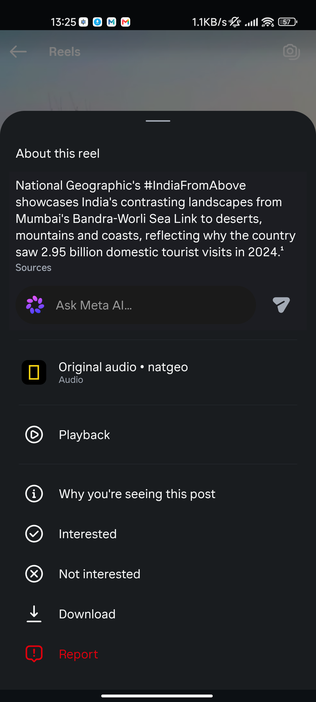

# Oxbow

**Instagram, off the stream.** An oxbow is a calm lake cut off from a river's main
current. Oxbow is a patched Instagram for Android that takes out the endless parts
and adds back the few things worth keeping — so it works for DMs, stories and saving
posts, without the slot machine.

[](https://github.com/aic0d3r/oxbow/releases/latest)
[](LICENSE)
[](https://github.com/aic0d3r/oxbow/releases)

| Download from Instagram's own ⋯ menu | Settings: long-press the Home tab |
|---|---|
|  |  |

## What Oxbow removes

The home feed, Reels, Explore, suggested posts, ads, telemetry and tracking
parameters in shared links — each with its own on/off switch, plus a permanent
lock you can't undo without wiping app data. From FeurStagram it also inherits:

- **Comments off** — no comment buttons, no comment sheets (optional, off by default)
- **No endless scrolling** — a reel opened from a DM, profile or search stays one reel

## What Oxbow adds

- **Download** anything — posts, carousel slides, videos, Reels, stories, highlights —
  from Instagram's own `⋯` menu, as a native "Download" row. Full-resolution files,
  saved through Android's download manager (no storage permission needed).
- **HD profile pictures** — long-press any avatar on a profile.
- **Ghost mode** — stories aren't marked seen, DMs send no read receipts, no typing
  indicator (optional, off by default).
- **Clean links** — `igsh`, `utm_*`, `obrf` and every other tracker stripped from
  copied and shared links.

Files land in `Pictures/Oxbow` and `Movies/Oxbow`, fetched straight from
Instagram's CDN using data the app already loaded — nothing extra is asked of
Instagram.

## Install

**Option 1 — prebuilt APK** (simplest). Grab it from
[Releases](https://github.com/aic0d3r/oxbow/releases/latest):

- `oxbow.apk` — replaces Instagram (uninstall Instagram first)
- `oxbow-clone.apk` — installs next to your existing Instagram

Updates are checked from inside the app on launch. Obtainium works too: add
`https://github.com/aic0d3r/oxbow` and filter APKs by `oxbow\.apk$` (or
`oxbow-clone\.apk$`).

**Option 2 — patch it yourself with [Morphe Manager](https://morphe.software)**
(no prebuilt APK involved; updates arrive through the Manager). On your phone,
open
[`morphe.software/add-source?github=aic0d3r/oxbow`](https://morphe.software/add-source?github=aic0d3r/oxbow&name=Oxbow&app=com.instagram.android),
or add the source `github.com/aic0d3r/oxbow` by hand, then patch Instagram (an
`.apkm` bundle from APKMirror). Enable *Clone* to install next to Instagram.

**Not on F-Droid**, and it can't be: F-Droid only ships apps it builds from
source, and Oxbow is a patch on top of Meta's closed Instagram APK.

## How it compares

| | FeurStagram | piko | **Oxbow** |
|---|---|---|---|
| Block feed / Reels / Explore / ads | ✅ | partly | ✅ |
| Permanent lock | ✅ | Focus Lock | ✅ |
| Downloads | ❌ | ✅ | ✅ native row + HD avatars |
| Ghost mode | ❌ | ✅ | ✅ |
| Clean share links | ❌ | ✅ (misses `obrf`) | ✅ |
| Comments off / one reel at a time | ❌ | ✅ | ✅ |
| Works on Instagram 452 | ✅ | ❌ | ✅ |

## Is it safe?

Oxbow does not collect, proxy or store your credentials; every patch is open
source. It is an unofficial modified client, not affiliated with Meta — using it
may violate Instagram's terms, and ghost mode or downloads give Instagram more
signals of a modified client. Use at your own risk.

## Build it yourself

Needs JDK 21, the Android SDK, a GitHub token with `read:packages` (for the
Morphe patcher) and an Instagram `.apkm` from APKMirror. Details in
[docs/BUILD_FROM_SOURCE.md](docs/BUILD_FROM_SOURCE.md).

```sh
./build.sh instagram.apkm            # -> oxbow.apk
./build.sh instagram.apkm --clone    # -> oxbow-clone.apk
./release.sh instagram.apkm          # both, signed, published as a GitHub release
```

How the patches find their way into Instagram's obfuscated code, and why they
survive updates: [OXBOW.md](OXBOW.md).

## Credits & license

Oxbow is a fork of [FeurStagram](https://github.com/jean-voila/FeurStagram) by
Jean Herail — all of its blocking, its settings page and its update system come
from there, and Oxbow follows it for new Instagram versions. GPL-3.0: see
[LICENSE](LICENSE) and [NOTICE](NOTICE).
